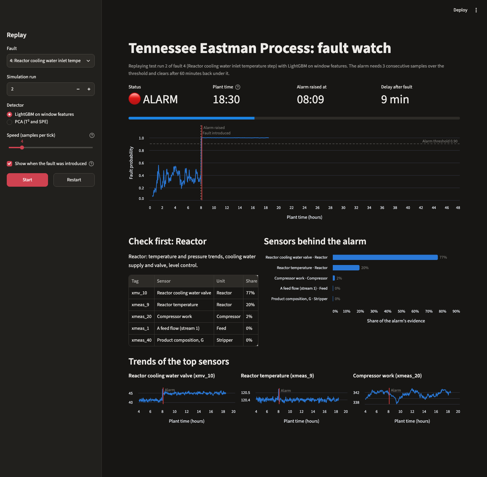

# TEP Fault Detection

Early fault detection on the Tennessee Eastman Process benchmark, built as a predictive maintenance tool for a plant operator. It should raise an alarm soon after something goes wrong, rarely when nothing has, and say which part of the plant to look at.

I compare two detectors under the same alarm rule:

- PCA with T² and SPE, the classical multivariate process monitoring method.
- LightGBM on windowed features (30-minute rolling mean, standard deviation and slope of every sensor).

## The process

The Tennessee Eastman Process is a simulation of a real chemical plant, published by Downs and Vogel of Eastman Chemical in 1993 as a test problem for control and monitoring.

- Four gas feed streams bring in the reactants (A, C, D, E) and a little inert (B).
- In the reactor the gases react over a catalyst to form two liquid products, G and H, plus an unwanted byproduct F. The reactions give off heat, so the reactor is cooled with cooling water. If cooling falls behind, temperature and pressure climb, and the plant trips at high pressure.
- The condenser cools the reactor's outlet gas so the products condense. A separator drum splits liquid from uncondensed gas.
- The compressor recycles the uncondensed gas to the reactor. A small purge stream is vented so the inert and the byproduct do not build up.
- The liquid goes to a stripping column, where steam and fresh feed strip out leftover reactants. Product leaves from the bottom.

The plant runs under closed-loop control. When a disturbance hits, the controllers move valves to hold temperatures, levels and pressures steady. So a fault often shows up in a valve position while the measurement that valve protects stays flat, and some faults are hidden almost completely.

There are 52 variables: 41 measurements (flows, temperatures, pressures, levels and delayed composition analysers) and 11 valve positions. The benchmark defines 20 faults, including step changes, random variation, a slow drift, sticking valves and five whose cause was never published.

## Data

Rieth, Amsel, Tran and Cook (2017), *Additional Tennessee Eastman Process Simulation Data for Anomaly Detection Evaluation*, Harvard Dataverse, [doi:10.7910/DVN/6C3JR1](https://doi.org/10.7910/DVN/6C3JR1).

| File | Runs | Length | Fault starts |
|---|---|---|---|
| Fault-free training | 500 | 25 h (500 samples) | none |
| Faulty training | 500 per fault × 20 faults | 25 h | after 1 h |
| Fault-free testing | 500 | 48 h (960 samples) | none |
| Faulty testing | 500 per fault × 20 faults | 48 h | after 8 h |

One sample is 3 minutes. `python -m tep.download` reads the file list and checksums from the Dataverse API, downloads about 1.4 GB, verifies every file against its published MD5, and converts to Parquet. If anything fails it stops with an error. It never falls back to other data.

## Quick start

Requires Python 3.12. On macOS, LightGBM also needs `brew install libomp`.

```bash
python3.12 -m venv .venv && source .venv/bin/activate
pip install -e ".[dev]"

python -m tep.download      # fetch and verify the dataset (about 1.4 GB, plus 1.6 GB of Parquet)
python -m tep.train         # fit both detectors, calibrate alarm thresholds (under a minute)
python -m tep.evaluate      # held-out results on the full testing files -> reports/ (about 95 s)
pytest

uvicorn tep.api:app                    # scoring API on :8000
streamlit run dashboard/app.py         # operator dashboard on :8501
```

## How it works

### Split by simulation run, never by row

A run is 25 or 48 hours of strongly autocorrelated samples from one random seed. Splitting rows at random would put near-identical neighbours on both sides and inflate every score, so I split on whole runs.

There is a second trap. In this dataset run number *k* uses the same random seed for every fault and for the fault-free file. The first hour of run 17 under fault 4 is bit-for-bit identical to the first hour of fault-free run 17, so splitting by (fault, run) pairs would still leak. I assign each run number to exactly one set and apply that assignment across all faults. A test checks the shared-seed property on the real files.

| Set | Source | Used for |
|---|---|---|
| Train | 300 run numbers from the training files (300 fault-free runs, 80 runs of each fault) | Fitting PCA and LightGBM |
| Tune | 50 run numbers from the training files | Early stopping for LightGBM |
| Calibrate | 150 run numbers from the training files, fault-free only (3,750 h) | Setting alarm thresholds |
| Test | The separate testing files, generated from different seeds | Every number reported below |

### The two detectors

The PCA model is fitted to standardised fault-free data and keeps 31 components (90% of variance). T² measures how far a sample sits from normal operation inside the model. SPE measures how badly the usual relationships between sensors are broken. Each is divided by its control limit and the larger ratio is the anomaly score. The limits are empirical 99th percentiles, because the textbook F and chi-squared limits assume independent Gaussian samples and closed-loop process data are neither.

The LightGBM model is a binary normal-versus-fault classifier over 156 features: the mean, standard deviation and least-squares slope of each of the 52 variables over a trailing 30-minute window. Windows are causal (they use only past samples) and never cross a run boundary. The anomaly score is the predicted probability of a fault.

### One alarm rule for both

Each detector produces one score per sample. The alarm is raised when the score has been over its threshold for 3 consecutive samples (9 minutes), which is ordinary alarm debouncing. Each threshold is calibrated on the fault-free calibration runs to the same budget of at most one false alarm per week (0.14 per 24 h), so the detection delays of the two models can be compared directly. The fastest possible detection under this rule is 9 minutes.

## Results

All numbers are from the held-out testing files and use all 500 fault-free runs (24,000 hours) and all 500 runs of each fault (10,000 faulty runs, 40 hours of faulty operation per run).

The full evaluation takes about 95 seconds and peaks at about 4.5 GB of memory on an 8-core Apple M2 with 16 GB. For a quick check, `python -m tep.evaluate --normal-runs 200 --runs-per-fault 100` scores the first 200 and 100 runs in about 30 seconds.

### False alarms in normal operation

| Model | False alarms per 24 h | False alarms | Fault-free hours | Time in alarm |
|---|---:|---:|---:|---:|
| PCA (T²/SPE) | 0.20 | 202 | 24,000 | 0.06% |
| LightGBM | 0.17 | 169 | 24,000 | 0.11% |

Both models overshoot the one-per-week budget (0.14 per 24 h) on unseen data: PCA raises about 1.4 false alarms per week and LightGBM about 1.2. Some overshoot is typical when a threshold set on one batch of runs meets another.

### Detection delay by fault

"Detected" is the share of runs in which the alarm was raised at some point in the 40 hours after the fault began. The median counts undetected runs as never, so it reads "not detected" when fewer than half the runs were caught.

| Fault | Description | PCA detected | PCA median delay (min) | LightGBM detected | LightGBM median delay (min) |
|---|---|---:|---:|---:|---:|
| 1 | A/C feed ratio step, B constant (stream 4) | 100% | 15 | 100% | 18 |
| 2 | B composition step, A/C ratio constant (stream 4) | 100% | 39 | 100% | 48 |
| 3 \* | D feed temperature step (stream 2) | 28% | not detected | 37% | not detected |
| 4 | Reactor cooling water inlet temperature step | 100% | 9 | 100% | 9 |
| 5 | Condenser cooling water inlet temperature step | 100% | 9 | 100% | 12 |
| 6 | A feed loss (stream 1) | 100% | 9 | 100% | 15 |
| 7 | C header pressure loss (stream 4) | 100% | 9 | 100% | 9 |
| 8 | A, B, C feed composition random variation (stream 4) | 100% | 63 | 100% | 68 |
| 9 \* | D feed temperature random variation (stream 2) | 28% | not detected | 31% | not detected |
| 10 | C feed temperature random variation (stream 4) | 100% | 162 | 100% | 102 |
| 11 | Reactor cooling water inlet temperature random variation | 100% | 28 | 100% | 27 |
| 12 | Condenser cooling water inlet temperature random variation | 100% | 27 | 100% | 30 |
| 13 | Reaction kinetics slow drift | 100% | 123 | 100% | 135 |
| 14 | Reactor cooling water valve sticking | 100% | 9 | 100% | 12 |
| 15 \* | Condenser cooling water valve sticking | 32% | not detected | 34% | not detected |
| 16 | Unknown | 100% | 111 | 100% | 51 |
| 17 | Unknown | 100% | 99 | 100% | 94 |
| 18 | Unknown | 100% | 147 | 100% | 138 |
| 19 | Unknown | 99.8% | 189 | 100% | 15 |
| 20 | Unknown | 100% | 135 | 100% | 132 |
| n/a | **No fault (chance level)** | **29%** | not detected | **19%** | not detected |

\* Known to be hard to detect.

- LightGBM detects seventeen of the twenty faults in every test run. PCA does the same except for a single run of fault 19 out of 500. Step faults in the cooling water, feed loss and header pressure (4, 5, 6, 7, 14) are caught at or near the 9-minute floor.
- On most faults the two models are within a few minutes of each other. PCA is slightly faster on several step faults because it reacts to single samples, while the classifier waits for its 30-minute window to fill with faulty data.
- LightGBM is clearly better on faults that change the variability of a signal and leave its level alone: fault 19 (15 minutes against 189), fault 16 (51 against 111) and fault 10 (102 against 162). Rolling standard deviation and slope pick that up. A single-sample method does not.
- The kinetics drift (13) and unknown faults 17, 18 and 20 take 1.5 to 2.5 hours to be flagged by either model.

### Faults 3, 9 and 15: not detected

These three are the benchmark's known blind spots, and this project does not solve them.

The last row of the table is the baseline. It counts how often an alarm goes off in the same 40-hour window on fault-free runs. With thresholds calibrated for one false alarm per week, that happens by chance in 29% of runs for PCA and 19% for LightGBM.

| Fault | PCA detected | LightGBM detected | LightGBM mean delay when it does alarm | Caught within 1 hour (either model) |
|---|---:|---:|---:|---:|
| 3 | 28% | 37% | 18.8 h | 1% or less |
| 9 | 28% | 31% | 18.2 h | under 1% |
| 15 | 32% | 34% | 18.6 h | under 1% |
| No fault (chance) | 29% | 19% | 19.3 h | under 1% |

- PCA is at chance. Its 28 to 32% is indistinguishable from the 29% it scores on runs with no fault at all. Those "detections" are false alarms that happened to fall after the fault began.
- LightGBM is above chance but not useful. It flags 31 to 37% of runs against a chance level of 19%, so it has found some real signal. It still misses about two runs in three, and when it does alarm it is on average 18 to 19 hours after the fault began, barely sooner than a random false alarm (19.3 hours). At most 1 run in 100 is caught in the first hour.
- In all three faults the control system absorbs the disturbance and the measured variables stay within their normal noise.
- An operator should treat this tool as blind to faults 3, 9 and 15. Lowering the threshold to catch them would buy a small gain and cost many more false alarms across the plant.

With 500 runs per fault, a detection rate near 35% carries a sampling uncertainty of roughly ±4 percentage points. The differences between the three hard faults (31 to 37% for LightGBM) are at the edge of the noise.

### Process reasons for faults 3, 9 and 15

Each of the three has an easily detected counterpart of the same kind elsewhere in the plant, so the difficulty comes from where the disturbance enters. The table shows what a detector has to work with: over all 500 test runs, after the fault begins, the largest change in any variable's mean (in units of its fault-free standard deviation) and the largest rise in any variable's within-run variability. `python -m tep.signature` reproduces it.

| Fault | Description | Largest mean shift (fault-free SD) | Largest rise in variability |
|---|---|---|---|
| 3 | D feed temperature step (stream 2) | -0.25, Reactor cooling water outlet temperature | none (under 1%) |
| 4 | Reactor cooling water inlet temperature step | +6.92, Reactor cooling water valve | none (under 1%) |
| 9 | D feed temperature random variation (stream 2) | none (under 0.05) | ×1.03, Reactor cooling water outlet temperature |
| 11 | Reactor cooling water inlet temperature random variation | +0.54, Reactor cooling water valve | ×6.52, Reactor cooling water valve |
| 15 | Condenser cooling water valve sticking | none (under 0.05) | ×1.09, Condenser cooling water outlet temperature |
| 14 | Reactor cooling water valve sticking | +0.12, Reactor cooling water valve | ×13.69, Reactor cooling water valve |

Faults 3 and 9 disturb a feed temperature, and none of the 52 variables is a feed temperature. The disturbance can only be seen through its effect on the reactor, and that effect is small. Stream 2 is one of four fresh feeds. The fresh feeds are mixed with the recycle stream, which makes up about two thirds of the reactor feed (26.9 of 42.3 kscmh), so a change in the D feed temperature barely moves the temperature of the combined feed. The reactor's energy balance is dominated by the heat of reaction, and the sensible heat of one feed stream is a minor term in it. The reactor temperature controller makes up the difference with a trim on the cooling water valve. For the step (fault 3) the only trace is a quarter of a standard deviation in the cooling water outlet temperature and a smaller move in the valve. Reactor temperature does not move. For the random variation (fault 9) the mean does not move at all and the cooling water outlet temperature is 3% more variable.

Faults 4 and 11 are the counterparts. They disturb the temperature of the reactor cooling water, the stream that carries the reactor's whole heat duty. The same controller responds, but the valve has to move seven standard deviations (fault 4) or swing six times more than normal (fault 11). Both are caught within half an hour.

Fault 15 is a sticking valve in a part of the process that tolerates it. The reactor is exothermic and its temperature depends on precise cooling, so when the reactor cooling water valve sticks (fault 14) the temperature loop cycles and reactor temperature swings thirteen times more than normal. The condenser controller is not idle. In normal operation its output moves more than the reactor's (a within-run standard deviation of 1.5% of valve travel against 0.5%). But a small error in condenser duty only shifts the vapour-liquid split slightly in a separator whose level and pressure are already under control, and nothing downstream amplifies it. The result is a 9% rise in the variability of the condenser cooling water outlet temperature, 6% in separator temperature, and nothing else.

When LightGBM does alarm on these faults, the sensors it names are the ones in the table: reactor cooling water outlet temperature for faults 3 and 9, separator temperature and condenser cooling water outlet temperature for fault 15 (see [docs/attribution.md](docs/attribution.md)). A shift of a quarter of a standard deviation, or a few percent more variability, in one or two variables out of 52 beats chance over 40 hours. It does not raise a timely alarm at one false alarm per week.

More data or a different model on the same 52 variables is unlikely to help, because the information is barely there. A feed temperature transmitter on stream 2 would make faults 3 and 9 trivial. Valve position feedback or a stiction check on the condenser cooling water valve would do the same for fault 15.

## Fault attribution

When an alarm is raised, each model reports the sensors most responsible and the unit operation they belong to.

- PCA uses contribution plots. If SPE is the statistic over its limit, each sensor's contribution is its squared residual. If T² is, the contribution is that sensor's share of the T² sum.
- LightGBM uses TreeSHAP values for the alarming window, with each sensor's mean, standard deviation and slope features added together. Positive values push the prediction towards "fault".

The top five sensors are mapped to a unit through a lookup table (`src/tep/attribution.py`), and the unit carrying the most contribution is the one to check first.

| Unit | Sensors | Check first |
|---|---|---|
| Feed | Feed flows and feed valves (XMEAS 1-4, XMV 1-4) | Supply pressure, feed composition, feed control valves |
| Reactor | Reactor pressure, level, temperature, feed rate and feed analysis; cooling water outlet temperature and valve (XMEAS 6-9, 21, 23-28; XMV 10) | Temperature and pressure trends, cooling water supply and valve, level control |
| Separator | Separator temperature, level, pressure, underflow; condenser cooling water; purge rate, valve and analysis (XMEAS 10-14, 22, 29-36; XMV 6, 7, 11) | Condenser cooling water, separator level and pressure, purge valve |
| Stripper | Stripper level, pressure, temperature, underflow, steam; product analysis (XMEAS 15-19, 37-41; XMV 8, 9) | Steam supply and valve, level control, product composition |
| Compressor | Recycle flow, compressor work, recycle valve (XMEAS 5, 20; XMV 5) | Recycle valve position, compressor load, recycle flow |

I checked the unit each model named at its first alarm against where the fault physically starts, for up to 25 detected test runs per fault. Reactor cooling faults (4, 11, 14) are attributed to the reactor in every run by both models, and feed loss (6) to the feed. Feed composition faults (1, 8) are flagged at the compressor and fault 10 at the stripper, because that is where the control system's response first shows. So the attribution locates symptoms, and the operator still has to find the cause. For faults 3, 9 and 15 it is noise. The full table is in [docs/attribution.md](docs/attribution.md).

## Scoring API

`POST /score` takes recent readings, oldest first, one row of 52 values per sample in the order given by `GET /schema`. It needs at least 10 rows (one feature window) and 12 to apply the 3-sample alarm rule.

```bash
curl -s localhost:8000/score -H 'content-type: application/json' \
  -d '{"readings": [[0.25, 3664.0, 4509.3, ...], ...], "top_k": 3}'
```

```json
{
  "n_samples": 12,
  "alarm": true,
  "models": {
    "lightgbm": {
      "score": 0.99999, "threshold": 0.9031, "over_threshold": true, "alarm": true,
      "attribution": {
        "unit": "Reactor",
        "check": "Reactor: temperature and pressure trends, cooling water supply and valve, level control.",
        "top_sensors": [
          {"sensor": "xmv_10", "description": "Reactor cooling water valve", "unit": "Reactor", "share": 0.7461},
          {"sensor": "xmeas_9", "description": "Reactor temperature", "unit": "Reactor", "share": 0.2195}
        ]
      }
    },
    "pca": {"...": "same fields, plus t2_ratio, spe_ratio and which statistic alarmed"}
  }
}
```

`alarm` is `null` for a model when too few samples were sent to judge three in a row. `over_threshold` then reports the latest sample alone.

## Dashboard

`streamlit run dashboard/app.py` replays any faulty test run in simulated real time. Pick a fault, a run and a detector, press Start, and the anomaly score is drawn sample by sample. When the alarm rule is met the page shows the unit to check, the contributing sensors and their recent trends. The moment the fault was introduced can be shown or hidden, since a real operator would not know it.



## Limits of the benchmark

The benchmark is a clean, stationary simulation of one operating point. A real unit has sensor drift, bad data, mode changes, few labelled faults and operators who already have too many alarms. [docs/real-plant.md](docs/real-plant.md) goes through what I would change for each.

## Tests

`pytest` covers the feature windows (values checked against an independent rolling calculation, causality, no window across a run boundary), the leakage-free split, the alarm logic and the scoring endpoint. Unit tests run on small generated arrays, so they need no download and test mechanics only. When the dataset and trained models are present, extra tests check the shared-seed property, the saved split and a real fault through the API. Every result in this README comes from the real dataset.

## Layout

```
src/tep/
  download.py      fetch, verify and convert the dataset
  data.py          load runs, split by simulation run
  features.py      rolling mean, std and slope
  pca_monitor.py   PCA, T², SPE and contributions
  gbm.py           LightGBM detector and SHAP
  alarms.py        alarm rule, false alarm rate, detection delay
  attribution.py   sensor and fault lookup tables
  scoring.py       both detectors and thresholds as one bundle
  train.py         fit and calibrate
  evaluate.py      held-out evaluation and reports
  signature.py     how much each fault moves the measured variables
  api.py           FastAPI scoring endpoint
dashboard/app.py   Streamlit replay
reports/           results from the last evaluation
docs/              attribution table, notes on a real plant
tests/
```

## References

- J. J. Downs and E. F. Vogel, "A plant-wide industrial process control problem", *Computers & Chemical Engineering* 17(3), 1993.
- C. A. Rieth, B. D. Amsel, R. Tran and M. B. Cook, "Additional Tennessee Eastman Process Simulation Data for Anomaly Detection Evaluation", Harvard Dataverse, 2017.
